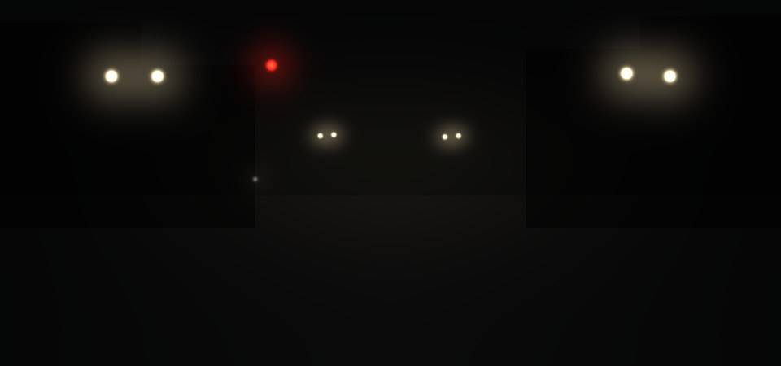
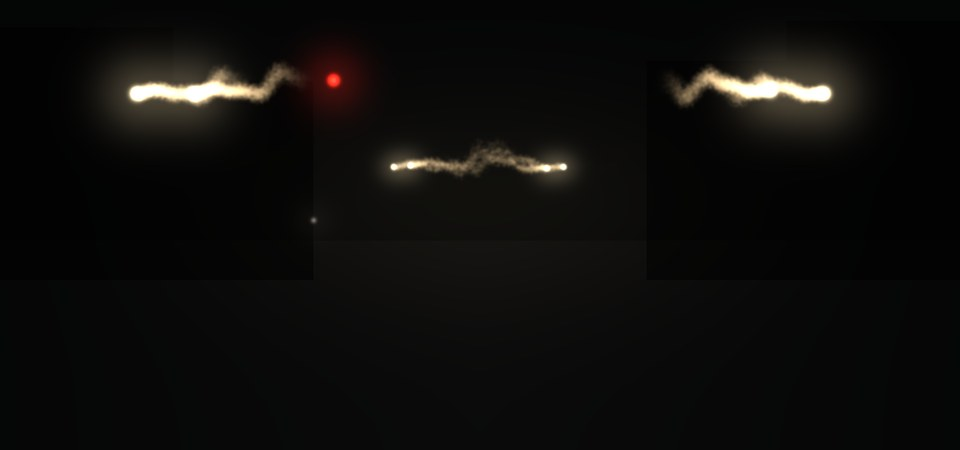
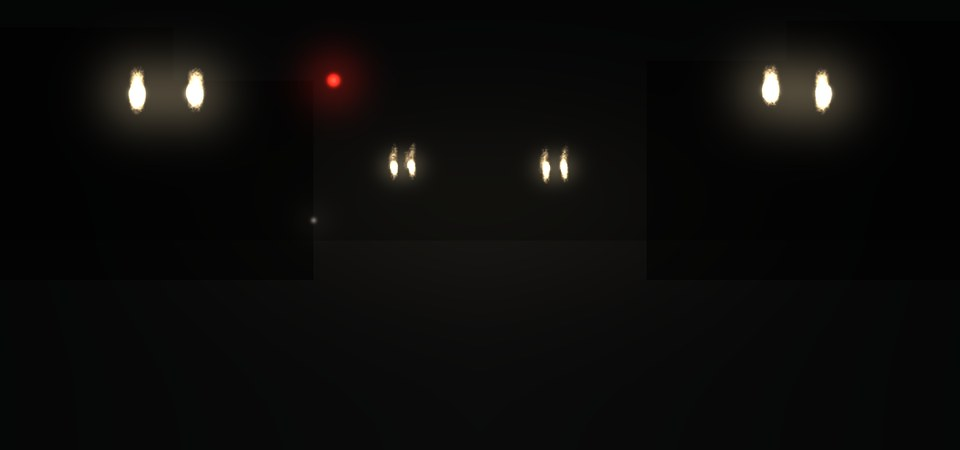
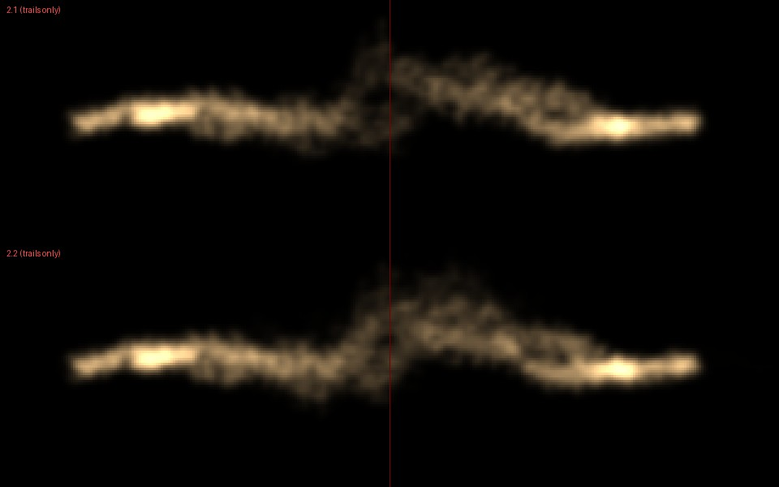

# Light Trails for DaVinci Resolve

Wavy, smoky trails from the hottest white lights. Every version is kept here, with a one-click Windows installer. Page: https://mohamedmabrook.github.io/light-trails/ (once GitHub Pages is on for this repo).

## Install

Download **[Install-LightTrails.bat](https://github.com/MohamedMabrook/light-trails/raw/main/Install-LightTrails.bat)** and double-click it. It lists every version and what's installed now. Press Enter for the recommended one, or type a number. It asks for administrator rights for OpenFX plugins, waits for Resolve to close, and backs up whatever it replaces to `%LOCALAPPDATA%\LightTrails\backup`.

PowerShell, same menu:

```powershell
irm https://raw.githubusercontent.com/MohamedMabrook/light-trails/main/install.ps1 | iex
```

A specific version:

```powershell
& ([scriptblock]::Create((irm https://raw.githubusercontent.com/MohamedMabrook/light-trails/main/install.ps1))) -Version 2.2
```

### Mac (Apple Silicon, macOS 13+)

In Terminal, with Resolve closed:

```bash
curl -fsSL https://raw.githubusercontent.com/MohamedMabrook/light-trails/main/install-mac.sh | bash
```

## Versions

| Version | Kind | Still lamps trail | Frames read per tweak | Notes |
|---|---|---|---|---|
| **[2.2 Mac](versions/2.2-mac/)** | OpenFX, Color page, Metal (Apple Silicon) | Yes | 1 | Same as 2.2, with lighter presets, unified memory and cheaper smoke; about 1.8× lighter at Medium |
| **[2.2](versions/2.2/)** (recommended, Windows) | OpenFX, Color page, CUDA | Yes | 1 | No centre seam, soft tails, Blend Softness slider |
| [2.1](versions/2.1/) | OpenFX, Color page, CUDA | Yes | 1 | Inward, Outward, Up or Angle streaks; likely Decay-crash fix; hard line at centre of frame |
| [2.0](versions/2.0/) | OpenFX, Color page, CUDA | No | 1 cached, up to 13 after a reset | Quality menu, depth, whites-only key; suspected crash |
| [1.1](versions/1.1/) | OpenFX, Color page, CUDA + CPU | No | 13 | Very slow; untick Use GPU for 1.0 behavior |
| [0.1](versions/0.1/) | Fuse, Fusion page | Only with Drift | 13 | First version; zip also holds the original DCTL |

1.0 (CPU only) isn't archived: its build was overwritten when 1.1 was compiled. 1.1 with Use GPU off runs the same CPU path.

| Source (lamps don't move) | 2.2 Inward | 1.1 and 2.0 (Follow Motion) |
|---|---|---|
|  |  |  |

Centre of frame, 2.1 (top) vs 2.2 (bottom): 2.1 sliced trails along the vertical centre line.



## Files

- `index.html`: the page (GitHub Pages serves it from the repo root).
- `versions.json`: the version list the installer reads.
- `install.ps1`, `Install-LightTrails.bat`: the Windows installer.
- `install-mac.sh`, `versions-mac.txt`: the Mac installer and its version list.
- `versions/<n>/`: each version's package, including full source.
- `img/`: comparison renders of a synthetic test scene.
